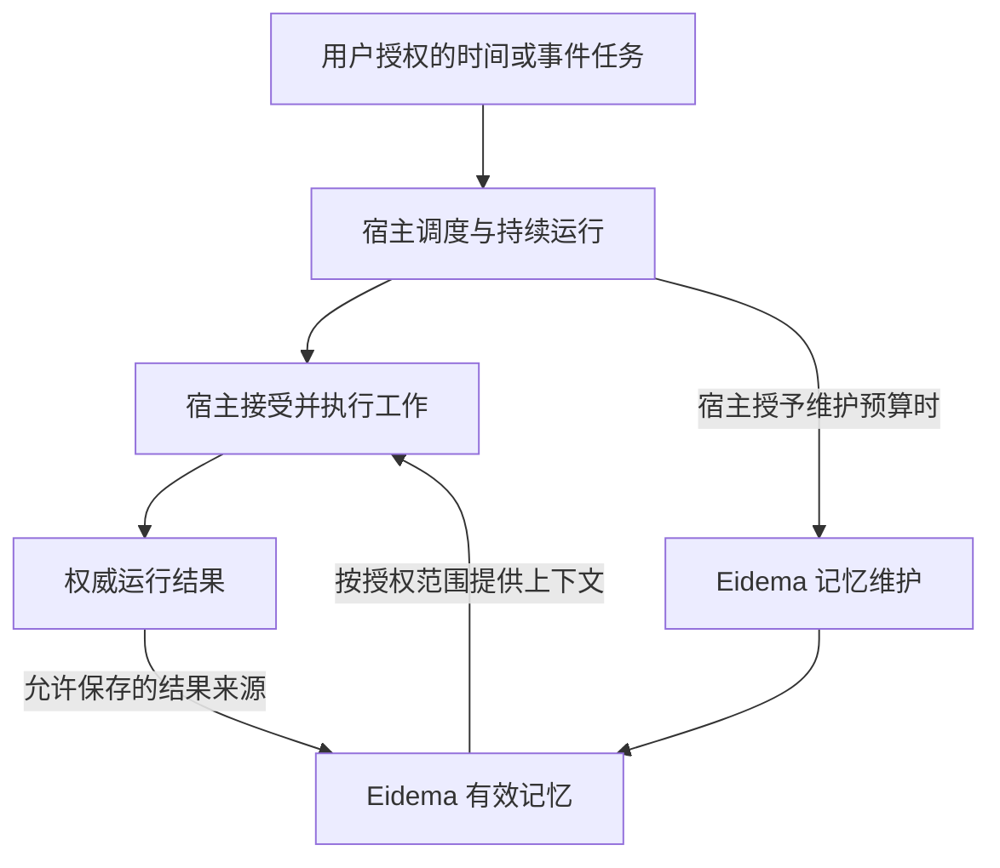

# 持久 agent：调度与持续运行的组件边界

日期：2026-10-23（Pacific/Auckland）。

状态：后续方向与职责说明。Amadeus 将作为持久 agent 演进，需要独立交代调度与持续运行组件；本文件不表示该组件已经实现，也不扩大 Eidema v1 的记忆实现范围。

## 1. 持久 agent 不止于跨会话记忆

Amadeus 的生命周期不会以一次聊天结束为边界。后续需要支持定时工作、事件触发、任务恢复，以及在用户没有正在发送消息时处理已经授权的工作。

持久化记忆支持这种连续性，但不等于已经具备持续运行或调度能力。运行环境、唤醒机制和工作派发应由独立组件负责。

“持续运行”也不意味着模型必须持续推理。调度器可以等待时间或事件，只有实际工作到期且运行条件满足时才消耗模型和执行资源。

## 2. 组件分工

| 组件 | 责任 | 不拥有的权威 |
| --- | --- | --- |
| Eidema Memory | 提供允许范围内的记忆，保存有来源的交互结果，执行有预算的记忆维护 | 不从记忆文字自行创建定时任务，不决定外部行动权限 |
| Persona | 使用角色设定与有效记忆组织表达；后续能力另行设计 | 不通过人设、关系或推断生成执行授权 |
| 宿主 Schedule / Persistent Runtime | 保存任务定义与调度状态，处理时间或事件触发、重启恢复、取消和运行预算，向宿主派发工作 | 不把派发动作等同于工作完成，不绕过宿主执行边界 |
| 宿主执行系统与权威记录 | 接受工作、检查权限、执行、记录结果与失败 | 不用记忆摘要替代真实执行回执 |

Amadeus 是这些能力的集成方。Eidema 的独立复用目标不要求其他宿主采用 Amadeus 的调度器或 Work Ledger。

逻辑上独立的组件不要求一开始就拆成多个仓库、服务或常驻进程。

## 3. 定时任务与记忆的区别

例如：

> “记住，我习惯周五回顾这一周。”

这是记忆内容，不能自行产生定时执行。

> “每周五晚上六点帮我整理本周工作。”

这是需要进入宿主调度流程的行动请求。具体时区、行动内容、范围、授权和交付位置需要由宿主确定，并保存为任务定义。

一项请求可以同时产生任务与相关记忆，但两者有不同的权威记录：

- 是否存在、启用或取消了某个 schedule，以宿主调度记录为准。
- 任务是否实际执行、产生何种结果，以宿主执行回执为准。
- 相关偏好、背景和已发生的历史，可以作为记忆保存并引用这些来源。

记忆整理不会激活、取消或修改 schedule。用户要求修改定时任务时，宿主处理真实变更，再使相关引用和派生记忆反映新的状态。

## 4. 一次调度工作的基本关系

这个流程只说明职责，不冻结调用接口。

派发工作与工作完成是两个不同事实。中断或结果未知时，恢复流程应查询既有运行记录并按动作语义恢复，不能把重试当作一定不会重复产生效果的操作。

## 5. 后台记忆整理与通用调度的边界

Eidema v1 的后台整理只处理已经允许接收的来源、记忆和派生索引。它需要保存处理进度并控制成本，但不因此成为通用 cron、任务执行器或主动 agent。

后续宿主调度组件可以触发记忆维护，并提供当前范围与预算。记忆组件仍负责本次维护的输入、结果版本与幂等提交；宿主负责何时运行、是否暂停和如何分配全局资源。

因此需要同时保留两个事实：

- 用户取消某个定时工作，不等于删除与它有关的所有历史记忆。
- 用户暂停自动记忆整理，不等于取消其他已经授权的定时工作。

对用户可见的控制应能明确区分它们。

## 6. 调度组件后续必须解决的问题

- **持久任务定义与运行状态**：重启后能够识别仍然有效的任务，以及已派发、完成、失败或结果未知的运行。
- **时间语义**：时区、夏令时、一次性与周期任务，以及设备离线导致的错过执行。
- **恢复与重复执行**：为每次计划触发提供稳定的运行身份；动作是否可重试取决于执行系统及其幂等能力，不能笼统承诺恰好执行一次。
- **授权与撤销**：有效的任务授权来自宿主配置；角色设定、旧记忆和模型推断不能恢复已经撤销的授权。
- **资源优先级**：协调前台聊天、语音、后台整理与定时工作，共享必要的并发和预算限制。
- **可见性**：能查看下次运行、最近结果、暂停与取消状态，以及无法运行的原因。
- **运行环境**：明确应用退出、设备休眠或关机后由什么进程或服务负责唤醒；数据持久化本身不保证这些情况下仍会执行。

具体的错过执行策略、部署方式和时间 API 尚未确定。

## 7. Eidema v1 需要为此保留的基础

- 接受宿主提供的稳定身份、授权范围和来源引用，不把所有输入写死为即时聊天消息。
- 支持记忆操作的重送识别、处理进度恢复和过时结果失效。
- 对检索与后台维护提供可观察的开销和明确的完成、待处理或失败结果。
- 允许将未来定时任务的执行结果作为一种来源接入，同时保持该结果的权威性归属。

这些能力已经由记忆生命周期本身需要。当前不新增尚无调用方的 schedule 数据表、调度协议、守护进程或执行接口。

## 8. 后续验收示例

| 情景 | 预期结果 |
| --- | --- |
| 程序重启后发现到期任务 | 根据保存的任务和运行状态处理，避免盲目重复执行 |
| 定时任务被取消，但旧记忆仍提到它 | 旧记忆不能重新激活任务 |
| 只保存了一条生活或工作习惯 | 不创建任何定时行动 |
| 定时工作读取记忆 | 只读取本次工作获得授权的范围 |
| 调度已派发但执行失败或结果未知 | 不能把“已派发”记成“已完成” |
| 同一次结果来源被重复送达 | 不形成重复记忆 |
| 自动记忆整理暂停 | 其他定时工作的有效状态不被隐式改变 |
| 设备无法在计划时间运行 | 可说明错过情况，并按明确策略处理 |

另见：[Eidema v1 记忆边界](v1-memory-boundaries.md)。

