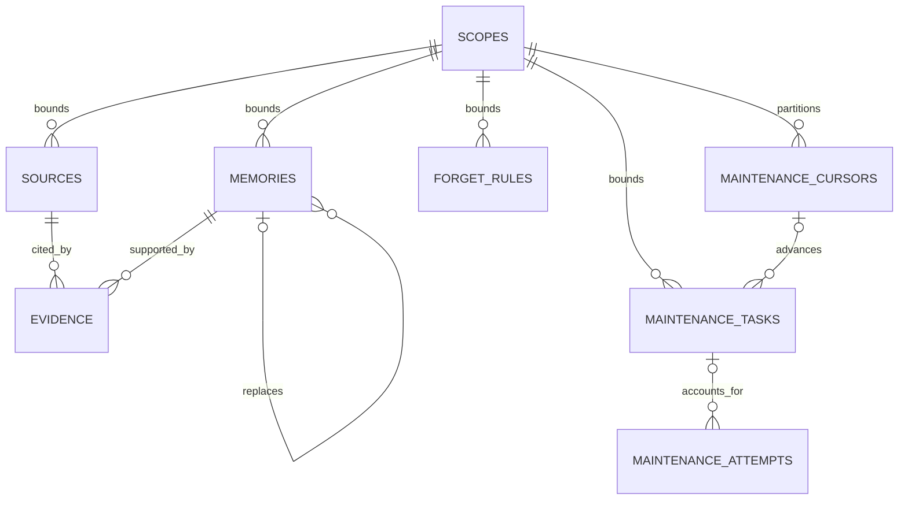

# Eidema v1：数据模型与记住、更正、遗忘

日期：2026-10-23（Pacific/Auckland）。

状态：数据设计提案，供逐项讨论；没有运行时实现或数据库迁移。初版按 **Python + SQLite、本地 Amadeus 优先** 的方向设计。本文已结合对初稿 ff27fc06 的外审复核修订；字段仍不视为冻结。本文细化[记忆边界](v1-memory-boundaries.md)与[数据及 runtime 讨论稿](v1-data-runtime-proposal.md)，不引入关系成长或调度实现。

## 1. 先确定的几个选择

1. **一条记忆表达一个可以独立更正、遗忘的陈述。** “喜欢咖啡且代码用 Python”拆成两条；必要的适用条件仍属于对应陈述。
2. **来源是一条宿主记录的确定版本；依据可以指向其中一段。** 不用 Session id、turn id 或文件修改时间代替逐条身份和时间。
3. **记忆正文不原地改写。** 语义更正生成新 `memory_id`，旧条目变更状态并指向接续条目。初版不另建通用版本历史表。
4. **偏好变化与事实记错分开。** 前者保留过去情况，后者不能再当作曾经成立的事实。
5. **遗忘删除内容，保留无原值的排除规则。** 规则同时约束记忆检索、原文检索、重新形成和在途任务。
6. **模型解释语义，Host 确认身份、来源、范围和用户操作。** 数据库不靠猜关键词判断更正、遗忘或共享意图。
7. **删除聊天保留显式记忆。** 明确保存的每项内容需要独立、持久的最小保存凭据；遗忘是另一项操作。

以下字段名是建议，不是已发布 API。类型中的 `?` 表示可空，其余必填；枚举需要校验，不能接受任意模型字符串。

## 2. 表与关系

**同一个 Eidema 项目，本地一个数据集使用一个 SQLite 数据库；表之间允许并需要关联。** 本节的“分组”不是独立仓库、服务或数据库。scope 中的 project_id 指宿主业务项目的访问范围，与 Eidema 代码仓库不是同一概念。

五组业务数据和必要辅助结构，建议共九张核心表；全文与向量等派生检索结构另计：

| 分组 | 表 | 原因 |
| --- | --- | --- |
| 来源 | `sources` | 保存宿主记录的版本引用和使用条件 |
| 记忆 | `memories` | 保存原子陈述及生命周期 |
| 依据 | `evidence` | 表达记忆与来源片段的多对多关系 |
| 遗忘 | `forget_rules` | 保留已删除记忆标识和来源排除位置 |
| 维护 | `maintenance_tasks` | 记录有界任务及输入版本 |
| 维护 | `maintenance_attempts` | 独立记录每次调用的预算预留、用量及结果 |
| 维护辅助 | `maintenance_cursors` | 保存连续处理到的位置，避免把任务结束误当成整个来源流已处理 |
| 范围辅助 | `scopes` | 复用用户、角色、项目范围，不在每张表里各解释一次 |
| 一致性辅助 | `store_state` | 保存库身份、格式版本、读取代数及来源序号分配状态 |

遗忘规则保存的是可在删除后继续存在的标识，因此不对已删除的记忆建立外键。维护任务的输入快照可以引用后来被删除的对象，提交时必须重新验证；不能因为输入还写在任务里就把它视为仍然有效。

## 3. 通用约定与范围

### 标识、时钟和变更序号

- 对外标识使用不含事实内容的不透明字符串。名称、台词、正文哈希都不充当身份或遗忘墓碑。
- 生命周期时间使用 Host 时钟提供的 UTC 毫秒。它们用于记录，不用于解决并发；并发使用版本及事务。
- `row_version` 从 1 开始，在影响该对象使用方式的变更中递增。它不是消息内容版本，也不是事实可信度。
- `store_state` 为单行：`store_id`、`schema_version`、`change_seq`、`next_source_seq`。后两个整数在写事务内推进，不回退、不复用。
- `change_seq` 在来源可用视图、记忆、依据或遗忘规则变化时递增，可用于发现读取结果过时。任务心跳和费用记账本身不要求使全部检索缓存失效。
- 后台提交验证实际读取的对象版本，不要求整个库的 `change_seq` 完全不变；无关的新聊天不应导致反复重跑。

### scopes

| 字段 | 类型 | 语义 |
| --- | --- | --- |
| `scope_id` | TEXT，主键 | 范围标识 |
| `user_id` | TEXT | Host 确定的用户身份 |
| `character_id` | TEXT? | 非空表示限定角色；空表示获得授权的角色共享 |
| `project_id` | TEXT? | 非空表示限定项目；空表示没有项目限制 |

空值在这里表示明确的“不限制该维度”，不是身份未知。未知用户或角色不能通过填空获得共享权限；标识不允许空字符串。同一范围组合只保存一次。

范围元组本身不原地改写。范围变化使用另一条 scope，并重新验证相关来源和记忆；不能修改一个 scope 的含义而意外放宽所有引用它的记录。

Host 提供当前用户、角色、项目和有效授权。范围元组只是本地过滤条件，不是新的权限来源。后台的输出范围不能宽于依据允许的范围；不能混合相互隔离的来源后再靠提示词隔离。

共享采用显式的可见范围迁移，保留同一个 memory_id，不复制出第二条活跃事实。Host 提供获准向目标范围披露的最小凭据，写入一个完整的、适用于新范围的依据组，再改变该记忆的 scope_id 与 row_version。原私有消息的权限不放开，私有依据不会披露给其他角色。

范围迁移是用户明确授权的元数据变更，使用预期 row_version 与稳定操作标识；旧共享请求不能在撤销后重放。更正一条已经共享的记忆，接续条目继承其当前范围，并需要同范围的有效凭据。普通私聊或后台推断不能自行改写共享值。

这是单一当前事实的迁移，不是“偏好变了”；不为共享制造 superseded 历史，也不复用 context_ref 冒充副本血缘。取消共享同样改变当前可见范围。若将来要允许各角色持有独立分支，须另行设计，不能由复制隐式产生。

剧情时间点、世界线和人物知识边界不塞进 `scopes`。本版通过来源性质、陈述和适用条件保留相关语境，完整人格策略后置。

## 4. sources：已提交来源的确定版本

原始文本仍由 Host 管理。一个 `sources` 行引用一个不可变的原始版本；编辑原文产生另一行，而不是悄悄更换同一引用对应的正文。

| 字段 | 类型 | 语义 |
| --- | --- | --- |
| `source_id` | TEXT，主键 | Eidema 内部稳定引用 |
| `source_seq` | INTEGER，唯一 | 首次接收时分配的单调序号，用于增量处理；不是事件时间 |
| `host_namespace` | TEXT | 来源标识的签发宿主／数据集命名空间 |
| `record_key` | TEXT | Host 原始记录的稳定标识 |
| `record_revision` | INTEGER | Host 为同一原始记录持久分配的正整数修订号，严格递增；不能按到达顺序临时编号 |
| `kind` | ENUM | `user_message / assistant_message / host_result / external_document / user_control` |
| `speaker_ref` | TEXT? | 已知的说话者／产生者身份；不从台词猜身份 |
| `context_ref` | TEXT? | Host 的 Session、Work 等上下文引用；邻接顺序由 Host 提供 |
| `scope_id` | TEXT，外键 | 此版本允许使用的范围 |
| `recorded_at_ms` | INTEGER? | 原始记录提交时间；旧数据没有逐条时间时为空 |
| `source_timezone` | TEXT? | 来源当时的时区语境；未知时为空 |
| `ingested_at_ms` | INTEGER | Eidema 接收时间，不能代替原始时间 |
| `use_policy` | ENUM | `recallable / formable / evidence_only`，见下文 |
| `status` | ENUM | `available / superseded / blocked` |
| `status_reason` | CODE? | 缺失、权限撤回、排除位置尚未映射等机器原因，不含正文 |
| `row_version` | INTEGER | 范围、可用性、排除视图等变更的版本 |

唯一键为 `(host_namespace, record_key, record_revision)`。同一来源重送返回原有行，不分配新序号。相同版本引用却返回不同内容属于 Host 契约错误，不能当作一次正常更新。

`recallable` 允许形成与按需证据召回；`formable` 允许形成、定位证据，但默认不将角色原台词注入普通回答；明确查证／原话查询仍可在允许范围内取必要片段。`evidence_only` 只供明确操作或已有记忆引用，不参与独立搜索和自动形成。一般用户消息可为 recallable，助手消息默认 formable，控制输入及其确认复述为 evidence_only。策略不替代访问权限。

Host 标记整个已识别的控制往返：记住、更正、遗忘的输入及与该操作关联的确认输出。不能只凭同一 turn 就假定所有输出都是确认，也不能靠回复关键词猜测。v1 的 use_policy 作用于来源记录；含确认复述的混合消息整体按 evidence_only 处理，其他独立消息按各自策略处理。代价是混合消息中的其他内容也不自动形成；片段级策略需要另行设计，不能在现有表中假定已经支持。

原始修订号与 `row_version` 分别解决“引用哪份文本”和“现在还能如何使用”。旧修订乱序到达不能替换已知的新修订。Host 不具备可靠修订顺序时，适配器须先确认当前版本，不能把到达顺序当作版本权威。

原文修订或撤回会改变依赖该来源的依据组。只有缺少任何完整有效依据组的条目才因来源问题失效；用户已明确撤回、更正或遗忘的状态则不能靠另一个依据组自动恢复。

### 删除聊天与独立保存凭据

已确认的产品语义是：删除聊天不会撤销用户之前的显式保存。Host 适配器为每个显式保存项提供稳定的 user_control 凭据，包含保存的内容、必要的原始片段、身份、范围、操作键和时间；不复制整段聊天。该凭据先持久提交，记忆及依据随后原子提交；只有两者都完成才向用户确认已保存。恢复使用同一操作键，不重做语义判断。

凭据是该项保存的独立来源，生命周期由明确更正／遗忘及有效授权管理。原聊天的位置作为 origin 关联保留，不作为独立凭据可用的前提。清理聊天后，界面仍可解释“这是此前明确保存的内容，原聊天已删除”。

删除聊天、真正撤销使用权限与遗忘内容是不同动作；独立凭据不允许绕过权限撤销。自动形成的记忆按剩余完整依据组判断；删除前可列出影响，删除后使用 status_reason 解释结果。Host 的凭据只是记忆操作的最小记录，不是另一套通用工作账本。

### 片段坐标

依据与排除规则均使用规范来源文本上的 Unicode 码点半开区间 `[start_cp, end_cp)`。不是 token、UTF-8 字节或 UTF-16 code unit。Host resolver 必须返回该版本固定的规范文本；不能在标注后重新归一化换行、标点或控制标签。

起止同时为空表示整条来源；否则要求 `0 <= start_cp < end_cp <= 文本长度`。不连续依据使用多行，不把中间无关内容一起纳入。未知坐标不能伪装成已验证片段。

## 5. memories：原子陈述及生命周期

| 字段 | 类型 | 语义 |
| --- | --- | --- |
| `memory_id` | TEXT，主键 | 一份陈述的身份；更正产生新身份 |
| `write_key` | TEXT，唯一 | 本次写入项的重送键，由 Host 操作 id＋项 id，或维护任务 id＋结果项 id 组成 |
| `scope_id` | TEXT，外键 | 可以使用这份陈述的范围 |
| `kind` | ENUM | `fact / preference / instruction / event` |
| `subject_ref` | TEXT? | 已知的主要用户、角色或项目身份；不强制建设实体图谱 |
| `statement` | TEXT | 一个中性、可独立处理的陈述；角色判断必须保留“曾表示”等归属 |
| `statement_lang` | TEXT? | 已知的 BCP-47 语言标记；混合或未知可以不填，不用于限制跨语言召回 |
| `condition_text` | TEXT? | 例如“提供代码示例时”“练日语时”；不是可执行规则 |
| `valid_from_ms` | INTEGER? | 有依据的有效期起点；未知不补成保存时间 |
| `valid_until_ms` | INTEGER? | 有依据的有效期终点，区间右端不含 |
| `occurred_from_ms`、`occurred_until_ms` | INTEGER? | event 的实际发生区间，不能和偏好有效期混用 |
| `time_precision` | ENUM | event 发生时间的 `unknown / instant / date / range` 精度；非 event 为 unknown，不把日期伪装成精确时刻 |
| `time_note` | TEXT? | “大学期间”“最近”等无法精确落到时间点的限定 |
| `origin` | ENUM | `explicit / derived`；表示形成方式，不等于事实真伪 |
| `status` | ENUM | `active / superseded / retracted / invalidated / merged` |
| `status_reason` | CODE? | 如 preference_changed、corrected_by_user、no_valid_support、scope_revoked、merged_duplicate；不存事实正文 |
| `replaced_by` | TEXT?，自引用外键 | superseded／retracted 的接续项，或 merged 的规范条目；删除接续项不恢复旧状态，删除合并目标须同时处理别名 |
| `created_at_ms`、`updated_at_ms` | INTEGER | 记忆创建及最近生命周期修改时间 |
| `row_version` | INTEGER | 状态、依据或有效期修改后递增 |

正文、主体和条件不原地改写；上述可变字段用于状态与依据管理。初版不默认设置模型生成的 confidence、好感度、情绪分数、行为奖励或向量列。向量是派生索引，不是记忆本体。

origin=explicit 只表示明确保存，不表示每轮注入。需要持续生效的人设与用户设置由 Host 配置层管理；instruction 条目是带来源的用户要求记录，不是新的 system 权限。初版不增加 always 字段，也不把所有 explicit 偏好自动选成常驻集合。

| 状态 | 含义 | 读取方式 |
| --- | --- | --- |
| `active` | 尚未被更正或撤回的陈述 | 按范围、条件及时间判断是否适用，不能等同于“现在必然为真” |
| `superseded` | 有接续陈述，旧情况仍可曾经成立 | 历史／时序召回可用；不把已过期的旧值当现值 |
| `retracted` | 明确指出原陈述错误 | 不作为事实召回；查看纠正记录时可展示其被撤回性质 |
| `invalidated` | 支撑内容或访问条件失效 | 不进入回答；重新形成需要有效来源 |
| `merged` | 重复条目已合并到另一条，保留旧写入身份 | 不进入事实或历史召回；沿 replaced_by 找到规范条目 |

有效期与状态分别判断。`superseded` 不表示它在所有历史时间都无效；未来生效的变更也不能提前抹掉旧值的适用期。缺乏具体切换时间时保留未知，不编造精确时间线。

event 的过去发生时间不能使其像过期偏好一样被当前检索排除。日期级事件只在时区有依据时转成当地日的起止区间，并保留 date 精度；时区或边界不明确则使用 time_note，不能虚构毫秒精度。

数据库不能用 `(subject_ref, kind)` 唯一键认定两条偏好冲突。一次更正需要明确目标记忆、操作性质和依据；条件不同的偏好可以共存。“今天先别纠错”默认留在当前交互，不因此改写长期条目。

后台可以形成有来源的派生条目，但不能凭自己的推断覆盖用户显式记忆。合法的用户新变更应通过其明确语义及来源处理。

更正状态也约束原文检索与再形成：已撤回断言的依据片段不能作为未标注的可学习事实，已变更断言只保留其历史适用性。后台不能绕开现有更正关系，从同一旧依据再造一条 active 的重复记忆；问“当时怎么说的”时可以展示带明确纠正／过期标注的原文。与更正片段无关的独立事实不受影响。

## 6. evidence：依据和状态变化的来源

| 字段 | 类型 | 语义 |
| --- | --- | --- |
| `evidence_id` | TEXT，主键 | 关联身份 |
| `memory_id` | TEXT，外键 | 关联的记忆 |
| `source_id` | TEXT，外键 | 引用的确定来源版本 |
| `start_cp`、`end_cp` | INTEGER? | 原文片段；同时为空表示整条 |
| `relation` | ENUM | `support / transition / origin` |
| `support_group` | INTEGER? | support 必填且为正整数；其余关系为空；组号仅在同一记忆内有意义 |
| `created_at_ms` | INTEGER | 建立关联的时间 |

`support` 支撑该陈述；`transition` 说明它为什么被更正、关闭有效期或撤回。两者不能混用：一句“现在改喝茶”能解释旧偏好为何结束，却不是“以前喝咖啡”的新增独立证据。

`origin` 记录原始位置与保留凭据的来历，不是必要支撑；它允许从旧消息追溯到已经独立保存的内容，也用于遗忘时发现关联副本。原聊天删除不因此使保存凭据失效。

同一 support_group 内全部必要，不同组可以替代。可用性要求生命周期允许读取，且至少存在一个完整、有效、获准用于本次读取的依据组。例如一句话说了两次可以是两组各一行，跨两条消息才完整的陈述是一组两行。组的数量不是可信度票数，复制或摘要不会增加事实权威。

必要来源失效时，应保留其不可用的元数据引用或使整组失效，不能删掉组内一行就把原本需要两条证据的组变成只需要一条。已被更正、撤回或遗忘的事实不会因“另一组还在”恢复为当前事实。

### 去重和合并

支持组解决替代证据，merged 解决旧写入身份，二者不能互相替代。只合并语义、条件、时间、归属和范围确实一致的条目；不能仅因主体与 kind 相同就合并。规范条目优先保留 explicit，同类时按稳定的创建顺序择一。

将重复条目的依据转入规范条目，保留每组的完整成员并分配不冲突的组号，origin 等关联也一并保留。被合并行保留 memory_id 和 write_key，状态为 merged，replaced_by 指向规范条目。旧键重送返回既有合并关系，不重新创建；原文对应片段也沿规范条目的生命周期处理。merged 不是“曾经成立的旧偏好”。

遗忘规范条目时，必须处理其合并别名、所有支持组、origin 关联及相关派生内容，封禁每个旧 write_key。删除合并目标不能留下可重新创建事实的孤立别名。更正后的重送可以返回旧保存项的当前状态及合法接续引用，不能把旧操作重新执行一次。

整理结果仍须关联原始 source 片段，不能只引用另一个摘要并丢掉根来源。依赖已有记忆时，任务记录其输入版本，结果保留实际使用的源级依据及适用性。这样，按来源片段反查 evidence 就能找到受影响的派生条目，无需初版另建通用依赖图。持久结果仍按原子陈述保存；为一次回答组合的多条上下文不自动变成新的混合记忆。

删除记忆时级联删除依据行。来源仍被引用时不能直接物理删除，应先处理相关记忆与关联。依据表不复制原文 excerpt；读取时按引用及排除规则取必要内容。若以后增加证据缓存，它也属于必须清理的派生数据。

## 7. forget_rules：删除后仍成立的排除依据

一个遗忘操作通常产生多条规则，用 `forget_id` 分组：被删除的记忆标识，以及支持其内容的来源片段。仅封禁旧 `memory_id` 不够，否则重新抽取会生成新 id。

| 字段 | 类型 | 语义 |
| --- | --- | --- |
| `rule_id` | TEXT，主键 | 排除规则身份 |
| `forget_id` | TEXT | Host 遗忘操作的稳定标识；重送不能扩大目标集合 |
| `scope_id` | TEXT，外键 | 本次操作的授权语境；不缩小已选规范来源的排除效力 |
| `target_kind` | ENUM | `memory / source_span / source_record` |
| `retired_memory_id` | TEXT? | memory 规则的已删除记忆 id，无外键 |
| `retired_write_key` | TEXT? | memory 规则对应的旧写入键，阻止旧明确操作重放 |
| `host_namespace`、`record_key` | TEXT? | 来源规则的稳定原始记录身份 |
| `record_revision` | INTEGER? | source_span 必填，与 sources 的 Host 修订号一致；source_record 不指定版本 |
| `start_cp`、`end_cp` | INTEGER? | source_span 的确定片段；source_record 表示整条记录的所有版本 |
| `created_at_ms` | INTEGER | 排除生效时间 |

按 target_kind 校验字段组合；规则不保存事实原文、摘要、关键词、embedding、正文哈希或可逆编码。范围、标识、坐标和时间用于防重放，不供模型当作回忆正文。

- memory：retired_memory_id、retired_write_key 必填，来源选择字段为空。
- source_span：规范来源三元组及非空起止坐标必填，memory 字段为空；只覆盖该版本的指定区间。
- source_record：host_namespace、record_key 必填，修订号、坐标及 memory 字段为空；只有用户意图确实覆盖整条记录时使用。

同一 forget_id 的目标集合固定并原子写入。重送复用该集合，不重新按当时的新数据扩展一次语义搜索；规则标识／目标唯一约束避免重复插入。

同一规范记忆的共享与合并关系必须随目标一并解析，不能通过换 scope 或凭据逃避遗忘。对于当前只有一个活跃记录的共享模型，遗忘该记录会影响所有获授权的读者；“只让某个角色不再读取”是可见性调整，不能偷偷当作局部物理删除。来源规则对已明确选择的规范来源及片段全局生效，不因读取者的 scope 改变而失效；选择目标之前仍须验证用户的删除权限与意图。

### 删除范围如何确定

- Host／交互层将用户意图解析为有权限的目标记忆和来源片段，Eidema 验证存在性、版本与范围。不能由后台重新猜一次用户要忘什么。
- 解析阶段还须在允许范围内查找未关联的提及，包括旧消息与助手复述。确定属于用户已授权遗忘范围的候选可直接纳入；对象、语境或删除范围有歧义时才向用户确认，不为每次遗忘机械增加一次审批。
- 对目标记忆收集其内容依据和已关联的重复表示；正文包含目标内容的混合摘要必须删除或失效，不能仅删一个关联行。
- 排除支持被忘事实的片段；不是无差别排除所有相邻依据。尤其不能因为旧偏好有一条 transition 指向新偏好，就把新偏好的来源一起排除。
- 片段交叠、引用不够细时，先明确受影响条目。不能为了省事默默丢掉同条来源中的其他独立事实。
- 指向被排除片段的 transition 不继续展开。旧条目不能恢复 active；是否保留具体终止时间，要看该时间是否也属于本次遗忘目标，不能无条件保留所有派生时间信息。
- 排除规则约束原文基线、词法与语义索引、证据展开和后台输入，不能只放在记忆表的查询尾端。
- 新记忆不得通过扩大共享范围绕过排除规则；较宽的输出范围包含被禁上下文时，也不能使用该片段形成内容。

### 版本变化与重新记住

片段坐标只对指定原文版本成立。同一 record_key 有部分遗忘后出现新 revision，Host 必须提供可靠的位置迁移或经授权的新来源；没有对应关系时，新版本在记忆路径中标为 blocked，不能拿旧坐标直接套用或当作全新来源绕过排除。旧版本中未被排除的独立片段仍可使用。

用户之后明确重新记住，应使用新的操作键和新的授权来源，生成新的记忆 id；原有规则保留，旧消息和旧操作仍不能自动复活。

本模型保证已解析目标及其关联来源不会重放，不承诺识别所有未关联、任意改写、冒用新身份导入的文本。相同原始记录的导入必须保留宿主命名空间与原始身份；不应把全新的副本身份当作遗忘已完整执行的证明。

### 可读失效与物理清理

遗忘事务删除正文、依据和 SQLite 内可同步删除的派生条目，同时写规则、更新受影响对象版本，并登记必要的清理任务。旧向量或缓存即使尚未物理清理，也不能再作为有效结果返回。

“检索已排除”和“所有受管理副本已清理”分别报告，不能在异步清理还没完成时声称全部删除。SQLite 空闲页、WAL、备份与外部 provider 的保留问题需要单独的物理清理与备份策略；本设计不声称字节级不可恢复。

原始 Session 的删除由 Host 管理，并保留此前独立保存的显式记忆。遗忘则同时处理对应保存凭据及派生物，跨组件清理完成前不得报告全部物理清除。旧库恢复应把当前排除规则纳入恢复流程；若只有遗忘发生前的备份而遗忘记录已丢失，就无法从旧备份推导后来发生的删除。初版导入应进入当前库并保留原始身份，不支持直接覆盖在线库来绕过当前规则。

## 8. 维护进度：输入、提交与费用分别记录

### maintenance_cursors

| 字段 | 类型 | 语义 |
| --- | --- | --- |
| `cursor_id` | TEXT，主键 | 一条增量形成流 |
| `scope_id` | TEXT，外键 | 同范围处理，禁止混合角色／项目 |
| `pipeline_version` | TEXT | 形成流程及配置版本，不含密钥或完整 prompt |
| `last_source_seq` | INTEGER | 已连续处理完的来源位置，初始为 0 |
| `row_version` | INTEGER | 防止旧批次覆盖新进度 |
| `updated_at_ms` | INTEGER | 最近推进时间 |

唯一组合为 `(scope_id, pipeline_version)`。初版游标只针对新增来源形成；重新授权旧来源、整理已存在记忆或重建索引使用明确目标任务，不通过回退游标来实现。

“处理完”可以是形成条目，也可以是因仅作依据、不可用或无可保存内容而跳过。不得因后面的一个任务成功就跳过前面的未完成范围。同一流初版串行推进，允许不同类型任务保留各自状态。

### maintenance_tasks

| 字段 | 类型 | 语义 |
| --- | --- | --- |
| `task_id` | TEXT，主键 | 任务及恢复身份 |
| `kind` | ENUM | `form / consolidate / index / purge`，只针对记忆 |
| `scope_id` | TEXT，外键 | 本次任务范围 |
| `pipeline_version` | TEXT | 所用处理策略／索引配置版本 |
| `cursor_id` | TEXT?，外键 | 增量形成时使用，其他任务为空 |
| `cursor_before`、`cursor_after` | INTEGER? | 同时为空，或形成任务拟推进的连续边界 |
| `input_refs` | 有界 JSON | 来源／记忆 id 和读取时 row_version；清理任务使用待删除派生物的标识 |
| `status` | ENUM | `queued / running / retry_wait / done / stale / failed / cancelled` |
| `active_attempt_id` | TEXT? | 当前获准接收结果的尝试；取消或完成后清空 |
| `next_attempt_at_ms` | INTEGER? | 有限重试最早时间，不能充当业务 schedule |
| `last_error_code` | CODE? | 机器错误类别，不保存含事实的原始异常／prompt |
| `created_at_ms`、`updated_at_ms` | INTEGER | 任务生命周期 |

input_refs 只保存标识和版本，不保存旧消息、待提交的生成正文或证据副本。处理中的正文仅在有界工作内存中存在；崩溃后如需重新调用，会重新计费。增量任务的输入集合与拟推进区间在开始前固定。

### maintenance_attempts

| 字段 | 类型 | 语义 |
| --- | --- | --- |
| attempt_id | TEXT，主键 | 单次尝试身份 |
| task_id | TEXT?，外键 | 所属任务；只有不再运行的任务可清理，账目可保留并将此引用置空 |
| scope_id、pipeline_version、operation_kind | 标识／枚举 | 费用归属的最小元数据，任务清理后仍可解释 |
| budget_window | TEXT | Host 确定的预算窗口，建立索引 |
| reserved_calls、reserved_input_tokens、reserved_output_tokens、reserved_embedding_tokens | INTEGER | 调用前预留的各项额度，均非负 |
| actual_calls、actual_input_tokens、actual_output_tokens、actual_embedding_tokens | INTEGER? | 已知的实际用量，均非负；未知不当作 0 |
| outcome | ENUM | prepared / in_flight / known / unknown / cancelled_before_send |
| started_at_ms、finished_at_ms | INTEGER、INTEGER? | 尝试时间 |

表中的用量项是分别命名的数值列，不再藏在任务 JSON 中。额度配置来自 Host，任务记录不能自行提高限额。提交预算预留前，在同一写事务内按窗口核对额度。每次尝试已知时计实际用量，否则计仍占用的预留；不能把同一次调用的预留与实际重复相加。

进行中或结果未知的尝试不得随任务清理。任务详情和费用记录采用分别配置的保留期；费用窗口关闭且未知项按明确规则结算后才能清理或归档。此处不构建通用调度或财务账本。

外部调用前持久化预算预留，返回后记录实际用量；结果未知的调用保留 unknown 并保守占用预留，不能在重启后当作免费调用。每日统计按每次尝试的预算窗口累计，不能按任务创建日期归账；失败、废弃结果和重试都计费。

### 后台提交的单一原则

**只有依据与目标仍符合计划读取时的条件，才提交本批结果。**

在短事务内验证任务仍在运行且结果属于 active_attempt_id，来源仍可用、来源／目标版本匹配、片段未被排除、范围合法、游标仍在 cursor_before、写入键未被撤销；然后将记忆、依据、派生更新任务、游标推进和任务 done 一起提交。无游标的任务不做游标检查；不需要外部调用的任务可以直接在本地事务中完成。模型调用不在数据库事务里。

迟到的旧尝试即使不能提交内容，其实际用量仍写回 maintenance_attempts；不能因为取消或重试就丢掉费用。

遗忘会推进受影响来源视图版本并删除目标记忆，使旧任务无法满足该条件。普通无关消息不要求任务重跑。失败或 stale 的任务不推进游标；恢复时先看持久状态，已经 done 的任务不再次提交。

## 9. 按三个操作走一遍

下列 U1、C1、S1、M1、W1 等只是便于阅读的示例标识。范围 SC1 为 `(U1, C1, 无项目限制)`；实际时钟由 Host 提供。

### 9.1 记住：同一句话中的两个事实

用户在 T1 说：

> 记住：我平时喝咖啡；代码示例请用 Python。

Host 提供 S1 的稳定记录身份、版本、T1 和范围；为两项显式保存分别提交独立凭据 R1、R2。S1 及本次确认回复仅作依据。本次语义写入含两个独立项。

| 新条目 | statement / condition | 状态 | 依据 |
| --- | --- | --- | --- |
| M1 | 用户平时喝咖啡 | active，explicit | support → R1；origin → S1 中“我平时喝咖啡”的片段 |
| M2 | 代码示例使用 Python／提供代码示例时 | active，explicit | support → R2；origin → S1 中“代码示例请用 Python”的片段 |

同一事务写入两条记忆和各自依据，write_key 分别为 W1.1、W1.2。记忆创建时间是 T1；“平时”的实际起点未知，所以 M1.valid_from 不填 T1。操作完成后立即可跨会话读取，不等待整理。之后删除 S1 所在聊天，R1、R2 仍可支撑这两项保存。

重送同一写入键返回已有结果；相同键却变成不同目标或载荷是契约冲突，不能静默当作新请求。初版明确操作的写入计划由 Host 持有并在重送时复用。

### 9.2 更正：现在变了，与过去就错了

**分支 A：变化。** 用户在 T2 说：

> 从现在起，我改喝乌龙茶。

| 对象 | 事务后的状态 |
| --- | --- |
| S2、S1 | S2 记录变化依据；S1 的使用视图因旧断言状态改变而推进 row_version |
| M1 | superseded，valid_until=T2，replaced_by=M3，row_version 递增 |
| M3 | 新条目“用户平时喝乌龙茶”，active、explicit，valid_from=T2 |
| 依据 | M3 的 support 指向新独立保存凭据 R3，origin 指向 S2；M1 增加相应 transition |
| M2 | 仍为 active |

当前饮品回答使用 M3；询问变化前的情况可以使用 M1，并说明其历史有效性。不能因保留旧条目就同时回答“现在既喝咖啡又喝乌龙茶”。

**分支 B：从 T1 出发的另一种情况，不接在分支 A 后面。** 用户说：

> 刚才记错了，我平时喝的是乌龙茶。

M1 应标记 retracted，新条目记录乌龙茶。不能声称“用户以前喜欢咖啡，后来改喝茶”。新的偏好实际开始时间仍可能未知；纠正时间只表示现在纠正了记录。

两种操作都新建内容条目，而不是覆盖 M1.statement。更正产生的新条目有独立 write_key，重送不会再次追加；相关状态修改、依据和新条目原子提交。

### 9.3 遗忘：保留同条消息中的无关事实

回到分支 A 的结果，用户在 T3 说：

> 忘掉我喝咖啡那段记忆，保留现在的饮品偏好和代码偏好。

解析后的目标为 SC1 内的 M1 及对应内容来源片段，不包括 M2、M3。

在同一事务中：

1. 写 memory 规则：保留 M1 的不透明 id 和 W1.1，阻止旧结果及旧写入重放。
2. 写来源规则：覆盖 S1 的咖啡片段及 R1 的独立保存内容；本次解析发现并纳入的其他提及也一并排除。
3. 删除 M1 正文与其 evidence；删除／失效相关摘要、FTS 条目并登记其他派生清理。
4. 更新受影响来源视图版本及 change_seq，使在途结果重新验证。

结果如下：

| 对象 | 结果 |
| --- | --- |
| M1 | 已删除；规则中没有“咖啡”原值 |
| M2 及其依据 | 保留，Python 代码偏好仍可召回 |
| M3 的 support | 保留，当前乌龙茶偏好仍可召回 |
| M1 → S2 的 transition | 关联随 M1 删除，但不能因此排除 S2 的新偏好内容 |
| S1 的 Host 原文 | 是否删除由 Host 决定；Eidema 展开证据或原文检索时排除咖啡片段 |
| “忘掉咖啡”的控制输入 | 仅作操作依据，不再被自动抽取成饮品偏好 |

若某个旧后台任务先前读取了 M1，其迟到结果因目标已删除、输入版本变化或排除规则存在而废弃。已花费的调用仍计入 maintenance_attempts。独立凭据和派生索引尚未清理完成时，返回清理中状态，不声称所有副本已清除。

同一 S1 再次导入时，唯一来源身份命中原有记录和规则；旧 W1.1 重送时返回已遗忘／不可重放，不重新创建 M1。重建索引也先应用排除规则。

若以后用户明确说“我现在又喝咖啡了，请重新记住”，使用新来源与新写入键创建 M4，并按新的变化处理 M3。M1 与旧来源排除规则不复活。

## 10. SQLite 约束与提交边界

此处列约束，不编写 DDL 或实现代码。

- sources 的规范来源三元组唯一；source_seq 唯一且不复用。不能直接依赖普通 ROWID 在删除后的分配行为来维持游标。
- memories.write_key 唯一；写入前同时检查遗忘规则中的 retired_write_key。
- 更正及去重在建立关系时要求同范围；之后的显式范围迁移可能使旧条目与当前目标的范围不同。每次沿 replaced_by 读取都重新验证目标权限，不能继承旧条目的访问资格；关系不能自指或成环。共享不复制第二条活跃事实。
- evidence 必须关联实际存在的来源和记忆，避免重复的同片段同关系关联；可用性按完整 support_group 判断。跨表的非空与完整性由写入口在提交前校验，恢复／迁移时做完整性检查，不假定普通外键能表达全部规则。
- 记忆生命周期改变了原文片段的可用性质时，同事务推进相应 source 的 row_version。只读取原文的旧任务也能发现更正，不依赖它恰好读过旧 memory。
- source_span 的版本与坐标、source_record 的整记录选择、memory 的退役标识分别校验；字段不允许任意混搭。
- scopes 的空值等价需要明确实现，不能假定普通 UNIQUE 会把多个 NULL 当作相同值。
- 每个 SQLite 连接明确启用外键约束。删除记忆级联删除 evidence；被引用的 source 不直接级联删掉尚未处理的记忆。
- 创建记忆及依据、更正的旧状态及新内容、遗忘规则及内容删除，分别在单个写事务中完成。
- 读取只使用已提交视图，不把数据库读事务跨越整个模型生成过程。返回内容带其对象版本和 change_seq；Host 在使用过时结果前进行失效处理。
- 优先索引来源三元组、scope＋source_seq、scope＋记忆状态、evidence.source_id、遗忘规则的范围与目标键、维护任务的状态与更新时间。全文和向量索引不代替这些约束。
- maintenance_attempts 按 budget_window 建索引；内容、删除记录和预算预留均以持久提交为确认边界。WAL 下采用 synchronous=FULL；同步成本仍需在目标设备测量。[SQLite 同步级别](https://www.sqlite.org/pragma.html#pragma_synchronous)
- 固定含 WAL-reset 修复的 SQLite 版本（如 3.51.3 或更新的受维护版本，或官方已回移修复的分支）。3.49.1 的探针结果不等于它可以直接作为部署基线。[SQLite WAL 说明](https://www.sqlite.org/wal.html)

### 派生索引与物理清理

原文全文索引属于遗忘契约，即使不保存完整正文，也可能保留可恢复的词项。evidence_only 不建立独立原文索引；formable 可以用于受控证据定位，普通注入策略另行限制。来源撤回／片段排除时立即使对应索引项不可读，随后执行可验证的清理。

对 SQLite 3.49.1 的独立内存探针中，使用 trigram、先插入提交再删除提交，以“咖啡豆”的 MATCH 确认删除前命中 1、删除后为 0，并检查 ft_data 中“咖啡”的 UTF-8 字节。普通 FTS 表开启 FTS5 secure-delete 后未发现该字节序列；但 contentless_delete=1 与同一 secure-delete 配置组合仍有残留，直到该探针执行 optimize。故不冻结“contentless-delete + secure-delete 就已清除”的假设，也不把一次 optimize 的结果等同于数据库文件、WAL 和备份的字节级擦除。

FTS 表形式、索引投影保存方式及清理完成条件必须在选定 SQLite 版本的落盘配置上验证；不能依赖已被 Host 删除的原文才能正确清理索引。存储及删除机制以 [FTS5 官方文档](https://www.sqlite.org/fts5.html)为依据；具体检索设计见[检索与上下文方案](v1-retrieval-context.md)。

### Amadeus 适配器约束

- 在权威写入边界给每条用户和助手消息分配并持久保存不透明 message_id，复用稳定 turn_id 关联；不能每次导入生成新 id。
- cooperative_delivery 的正文哈希回退不能直接成为 record_key；修复应在拥有消息身份的 Host 层完成。
- 中断或编辑改变内容时推进持久修订号；旧修订乱序送达不能重新激活。
- 优先接收该条消息完成提交与必要中断修订后的版本；之后发生真实修订仍按版本契约处理。不要把“等待消息完成”误写成等待一个长期 Work 或整个 Session 结束。
- 关闭某会话的长期采集时，Host 不把内容送入形成或检索索引；重新开启不自动回补，除非用户明确要求。

SQLite 官方说明：[外键需逐连接启用](https://www.sqlite.org/foreignkeys.html)、[ROWID 与 AUTOINCREMENT](https://www.sqlite.org/autoinc.html)、[唯一约束和 NULL](https://www.sqlite.org/lang_createtable.html)、[事务隔离](https://www.sqlite.org/isolation.html)。

## 11. 这版模型的验收问题

| 场景 | 必须成立 |
| --- | --- |
| 同一保存请求重复送达 | 不增加第二组记忆 |
| 同一消息包含两项事实，只遗忘一项 | 另一项仍可用，原文召回也不会带回被遗忘片段 |
| 用户改变偏好 | 旧值只在适当历史语境使用 |
| 用户否认先前记录 | 不把错误记录叙述成真实过去 |
| 用户要求临时例外 | 不自动撤回长期条目 |
| 更正／遗忘时后台仍运行 | 旧结果不提交，实际费用不消失 |
| 删除接续的新条目 | 旧 superseded／retracted 条目不会自动恢复 active |
| 重新导入旧来源、重建索引 | 原有规则仍阻止恢复 |
| 部分遗忘后源文本被编辑 | 无可靠坐标迁移时不盲目召回新版本 |
| 关闭程序后恢复任务 | 已提交任务不重复写入，未完成任务不冒充完成，未知调用仍占预算 |
| 切换角色或共享单条偏好 | 范围与证据披露一致，不连带共享其他消息内容 |
| 记住／遗忘后助手确认时复述了内容 | 确认不进入独立索引和再形成 |
| 发现未关联的旧提及 | 按授权和必要澄清纳入排除，不夸大未发现内容的保证 |
| 重复保存后合并，一组依据被删除 | 另一完整组可继续支撑；旧 write_key 不新建重复项 |
| 删除含显式保存的聊天 | 独立凭据与显式记忆保留，自动形成条目按剩余依据判断 |
| 共享后明确更正同一条记忆 | 仍只有一个当前事实，获授权角色使用同一新值 |
| FTS 行已删除但清理尚未完成 | 不可召回，且不提前报告物理清理完成 |
| 已确认保存后发生系统崩溃／断电 | 按已验证的持久配置恢复；不能用只测进程退出代替 |
| 中断修订与旧版本重放 | 不重复形成，不让旧正文重新成为当前版本 |

本文确立讨论起点：字段与生命周期服务于实际消费者。后续可以据此收敛接口、查询和预算阈值；当前不增加实现、迁移脚本、关系模型或通用任务框架。
