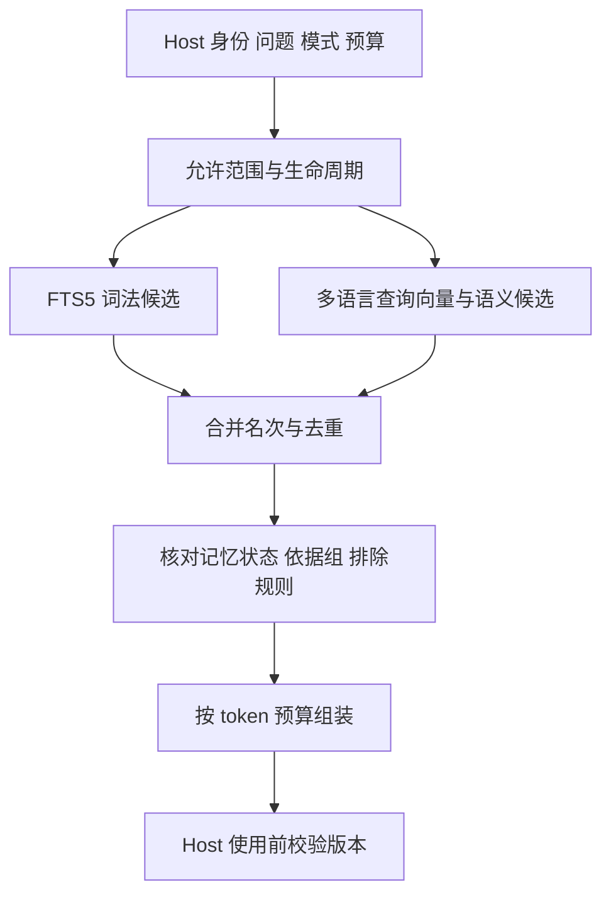

# Eidema v1：检索与上下文组装

日期：2026-10-23（Pacific/Auckland）。

状态：设计提案，无运行时实现、索引安装或模型性能测试。Python + SQLite 已确定为初版方向；本文的候选数、分块、token 与时间预算是实验起点，不能作为已达成的性能指标。数据生命周期以修订后的[数据模型](v1-data-model.md)为准。

## 1. 一条有界流程

> Host 提供身份、问题与预算 → 确定可用候选范围 → FTS5 与向量检索 → 按名次合并 → 回到权威记录检查 → 去重与上下文装配 → Host 使用前校验版本。

FTS 和向量都负责找候选，不决定事实真伪、访问权限或当前生效的用户设置。默认不增加翻译、查询改写、LLM 重排或上下文压缩调用。

## 2. 请求边界与模式

Host 提供当前用户、角色、项目、获准范围、问题文本、当前时间与时区、剩余上下文预算，以及本次检索的截止时间。可以附带明确的来源／记忆引用、已有上下文锚点和已解析的时间条件。

- `automatic`：普通回答前的补充，偏向少量相关记忆；不自动投送 formable 来源的角色台词。
- `lookup`：明确回忆或查证，可以检索并提供必要的来源证据，包括尚未形成记忆的助手消息。
- `quote`：明确查看原话，返回有来源与状态说明的原文片段。

模式改变使用方式，不扩大权限。模式来自 Host 的明确交互或既有语义处理，不新增一个“是不是记忆问题”的分类模型，也不靠关键词决定权限。

如果宿主只有在主模型请求工具后才知道需要 lookup，这就是一次工具往返，须计入整个回答的延迟与主模型费用；不能把它藏在“检索只花了几十毫秒”的指标后面。初版不承诺在未知用户意图时同时实现零额外往返、零原文暴露和完整的未整理助手记忆召回。

无可靠时间条件时，不把“上次”“那时候”猜成硬日期过滤。使用问题和 Host 已知的少量上下文检索，返回时间与状态，让现有回复模型解释。检索器不重写整段对话。

## 3. 检索单元与派生存储

核心九张表继续保存事实与生命周期。检索增加可重建的派生结构，仍在同一个本地 SQLite 数据集中：

| 结构 | 内容 | 不承担的责任 |
| --- | --- | --- |
| search_documents | 文档键、所属 memory／source、对象版本、scope、原文坐标、获准的索引投影、投影配置版本 | 不作为第二套权威聊天档案 |
| FTS5 虚表及影子表 | 同一检索单元的词法索引 | 不决定遗忘与授权 |
| document_embeddings | 文档键、embedding 配置标识、维度、向量 BLOB | 不成为唯一记忆，不把相似度当真实性 |

一条原子记忆通常对应一个检索单元，索引 statement、condition_text 和必要时间限定。过长时可产生多个搜索片段，但仍指回同一记忆；不能因此在上下文里重复计算多条事实。

原始来源按确定版本的句子／片段切分，保留规范码点坐标。实验起点为每片约 256 个 embedding tokenizer tokens、最多约 32 tokens 重叠；不跨来源权限或遗忘边界拼接。长记忆与来源必须明确分块，不能依赖模型静默截断。

排除片段后应拆开剩余区段，不能将原来不相邻的文字接成一句新证据。source.use_policy=evidence_only 的来源不建立独立原文索引；已保存记忆本身仍可按其状态建立索引。

formable 来源可以被索引用于证据定位、明确查证和形成，但不因命中就自动进入普通回答。原文检索基线的实验要记录模式与实际投送方式，不能将“搜索到了”与“已注入给主模型”混为一项指标。

### FTS 的维护与清理

初版优先验证 external-content FTS 与有界 search_documents 投影的方案：投影是敏感的派生材料，写入、删除与清理都由 Eidema 管理；原始事实的权威仍在 Host。维护索引时可取得原索引输入，不依赖 Host 原文在删除聊天后仍然存在。

不能假定外键级联会自动维护 FTS。写入器应在同一事务中更新检索投影与 FTS；遗忘先撤销候选资格，再执行可验证的索引清理。FTS 的 secure-delete、SQLite 页清理、WAL checkpoint 与备份策略是不同层次。

contentless-delete 可作为节省投影存储的对照，但当前 3.49.1 探针中它与 FTS secure-delete 的组合仍有词项残留，不能将该组合当作已通过的物理删除方案。配置须在最终选用的、包含相关修复的 SQLite 版本上复测。[FTS5 存储与删除说明](https://www.sqlite.org/fts5.html)

## 4. 先限制范围，再取 top-k

两个检索通道都只在本次获准、未被排除、版本仍匹配的候选集合中取 top-k。不能先从全库拿 20 条，再删除 19 条无权限结果，把真正相关的允许内容挤出。

预筛选包括 scope、来源使用策略、已知版本与生命周期；最终还要验证正文对应的记忆状态和至少一个完整、获准的 support_group。用于证明的来源可以与其他未披露依据同存，但只向当前读取者提供其获准的那组证据。

同一个 change_seq 的已提交视图用于解释检索快照。完成检索后只有少量选中对象需要重新校验；不把读事务一直保持到主模型生成结束，也不因无关新消息就从头重做搜索。

## 5. FTS5 通道

FTS 用于原词、名字、术语、路径与标识符。它不负责把“面试练习”理解为日文“面接の練習”。

建议的首个词法配置：

1. 在检索投影中做一致的大小写／宽度等规范化，原始来源与坐标保持不变。
2. 拉丁文本保留单词；下划线标识符、路径和带标点名称单独验证实际分词。不能把 unicode61 的默认标点切分误称为完整标识符匹配。中日韩连续文字生成双字片段；单字另放短词列，只在确实需要单字查询时使用。
3. 对这些显式分隔的词项使用 FTS5 unicode61；入库和查询采用相同配置版本。中文“咖啡”不会因为缺少空格而粘在整句中。
4. 短词、常用字与索引增长单独评测，不假定字片段等同于语言学分词。原生 trigram 可以作为对照，但不能覆盖所有一至二字查询。
5. 查询编译成引用、转义后的有限词项，以 OR 获取候选，按 BM25 排序；不能要求一句长问题的全部字片段都同时命中。明确短语与标识符的匹配另行验证，不把用户整段文本直接当 FTS 操作符语法。

FTS5 的 BM25 是数值越小越靠前；分数没有跨问题统一的概率含义。其默认 unicode61 和 trigram 的行为、以及短于三个字符的 trigram 全文限制，均由官方文档说明。[SQLite FTS5](https://www.sqlite.org/fts5.html#tokenizers)

不使用无界的全表 LIKE 扫描来掩盖短词设计缺口。词法结果没有足够信号时，允许这一通道为空。

## 6. 向量通道与中文查日文

首个待测模型选 Amadeus 已使用的 `intfloat/multilingual-e5-small`，减少初次接入变量；这不代表它已通过 Eidema 的跨语言测试。

- 查询与文档使用同一个模型修订、池化、归一化和前缀规则。
- 查询使用 `query: `，文档使用 `passage: `，中文与日文都保留这些前缀。
- 该模型输出 384 维向量；其输入长度限制要求显式管理分块，而不能静默丢掉后半段。
- embedding 输入是可读的原语言文本，不是 FTS 的字片段序列；不先把所有日文翻译成中文。
- 模型、配置或维度变化需要新索引版本，不混合不同向量空间。

这些格式要求来自[模型作者的说明](https://huggingface.co/intfloat/multilingual-e5-small/raw/main/README.md)。模型卡给出的通用成绩不能代替中文问题／日文证据的本地验证。

向量先保存在 SQLite 的普通 BLOB 列中，优先验证“范围内精确距离计算”的基线；可使用 sqlite-vec 的原生标量距离函数，避免 Python 逐元素计算。库版本及 Windows 打包能力仍需实现前验证。[sqlite-vec 的普通表检索方式](https://alexgarcia.xyz/sqlite-vec/features/knn.html)

逻辑上先限制允许行，再计算距离、排序和截取；实际执行计划必须验证。初版不先引入近似索引。若全量授权范围内的精确搜索达不到预算，再比较可在检索前限制范围的索引；不能偷偷只搜最近一部分历史，却称为完整语义召回。

Eidema 可以通过 Host 复用已加载的 embedding 能力，但不直接复用角色知识 RAG 的候选集合、权限或阈值。当前 Amadeus 角色 RAG 使用归一化向量的 L2 距离；本方案拟用 cosine，不能直接搬用旧距离门槛。

### 示例：只有日文来源时

用户问：“上次日语面试练习，我们讨论了什么？”

获准的助手来源片段为：

> 前回は、日本語の面接練習で自己紹介を短くする話をしたね。

lookup 请求的中文 query 向量与日文 passage 向量进入同一语义空间。FTS 可能没有足够同词命中；向量通道仍可以提出该候选，不能要求它同时命中 FTS。

有已形成记忆时，返回有依据的事件／陈述；尚未形成时，lookup 可以返回这段最小日文证据，标明“助手当时的陈述”、时间与出处，由现有回复模型组织回答。检索器不免费生成一份中文摘要，也不能仅凭助手这样说过就证明练习确实发生。

这是预期工作方式，不是已测到的相似度、排名或命中率。

## 7. 合并、相关性与去重

实验起点为普通模式每个通道最多 20 个候选，lookup 最多各 40 个。明确提供的来源／记忆 id 可以直接解析，但仍执行同样的范围和版本检查。

先按同一记忆身份、相同来源片段合并重复候选，再用 Reciprocal Rank Fusion 合并两路名次：

> RRF(d) = 1 / (60 + 词法名次) + 1 / (60 + 向量名次)

缺席的通道贡献 0，名次从 1 开始。60 是沿用论文的实验起点，不是未经验证的最优参数。采用名次合并，避免直接相加不同尺度的 BM25 与 cosine 分数。[RRF 原论文](https://plg.uwaterloo.ca/~gvcormac/cormacksigir09-rrf.pdf)

同一条记忆被拆成多个搜索片段时，每条通道只取其最佳名次，不因片段多获得多票。不同事实不能只因来自同一消息就被合并；整理后的记忆与重复原文也不相加为多份独立证据。

RRF 只解决排序，不证明相关。普通模式允许不注入任何记忆；词法与向量的纳入门槛须用有答案、无答案及跨语言留出场景标定。不能因为总有一个“第一名”就每轮强行填入内容，也不能随意规定一个通用的 cosine 0.8 阈值。

候选回到权威数据后：

- merged 跟随规范条目，不展示重复正文；每次跳转仍检查当前范围。
- 当前问题不能把 superseded 旧偏好当成现值。命中旧项时，应按允许范围展开必要的接续信息。
- 历史问题保留相关过去情况及时间；retracted 不作为事实，只在明确查看更正／原话时带标注展示。
- 已知更正链所需的新旧关系作为一个解释单元处理。预算不足不能只留下过期值而丢掉更正说明。
- 与近期已提供内容按身份和片段去重；不使用“被召回次数越多越重要”的强化规则。

语义矛盾不能只靠最新时间或最大相似度裁决。尚未关联的矛盾仍需主模型根据证据表达不确定，并纳入评测。

## 8. 哪些内容进入上下文

| 内容 | 普通模式 | 明确查证／原话模式 |
| --- | --- | --- |
| 相关、有效的原子事实与条件化偏好 | 可以，保留条件与归属 | 可以 |
| 相关过去情况 | 带历史状态与时间，避免冒充现值 | 按所问时间使用 |
| 获准的用户／资料原文 | 仅取必要证据，不整段倾倒 | 可按任务取片段 |
| formable 角色台词 | 默认不自动投送 | 可取必要引文，不当作风格样本重放 |
| 控制输入及确认复述 | 不作独立召回内容 | 仅沿操作／记忆依据明确查看 |
| 被遗忘、失权、失效内容 | 不进入 | 查证模式也不能绕过 |
| 当前人设与长期生效设置 | 由 Host 配置层装配 | 仍由 Host 配置层装配 |

长期保存和持续生效是两个职责。没有 always 字段，也不自动常驻所有 explicit 偏好。“喜欢咖啡”相关时召回；“练日语时纠错”保留条件；“以后默认用日语回答”由 Host 的当前设置负责。

同一用户要求若也留下记忆记录，当前生效值仍以 Host 配置为准。用户更正或撤销该设置时，由 Host 协调配置变更与相关记忆的生命周期；不能让被取消的要求靠旧记忆继续生效。

Eidema 返回内容与依据，Host 将其放在清楚的参考区，不重放为过去的 assistant／user 消息对象。记忆文本不产生执行授权或 schedule。角色原话即使带了引文标签仍可能影响表达，标签不能替代先例传播评测。

## 9. token 预算

只计按需记忆预算；Host 先为当前请求、稳定人设、当前设置、必要历史和回复留出空间，再给 Eidema 剩余额度。

| 实验档 | 记忆区总上限 | 内容单元上限 | 用途 |
| --- | --- | --- | --- |
| automatic | 512 个主回复模型 tokens | 4 | 普通回答的有界补充 |
| lookup／quote | 1024 个主回复模型 tokens | 8 | 明确回忆或查证 |

实际使用 Host 给定额度与本档上限中的较小值；没有有用内容可以为 0。这些数字用于首轮对照，不是已验证默认值。可比较更小预算和增加预算后的收益、人格影响，不因数据库变大就自动扩大注入量。

使用主回复模型的 tokenizer 计算最终序列化文本，包含标题、归属、日期、来源标识、状态和引文；不能用 embedding tokens 或字符数代替。Host 无可靠计数器时，只能标记估算并留余量，由 Host 负责最终请求窗口检查。

按相关性与任务所需解释单元装配，优先提供可以独立理解的陈述，再按需补依据：

- 不删掉条件、否定词、历史标注来强行塞入。
- 同一事实已有合适记忆表达时，不再重复放整段原文。
- 单个可选单元放不下就跳过并记录预算省略；不能声称已提供全部相关资料。
- 原话任务超出预算时返回已定位片段及剩余部分的引用，不假装这是完整原话。
- 前台不调用额外生成模型压缩超限上下文。

主模型可见区保留必要出处和状态；检索距离、RRF 分数、耗时和预算诊断返回给 Host，不全部塞进 prompt。

## 10. 延迟、超时与未完成索引

建议先按普通模式 150 ms、lookup 500 ms 的检索返回截止时间实验。普通档可先给范围及词法约 20 ms、查询 embedding 与向量候选约 100 ms、最终核验与装配约 30 ms；并行部分不重复相加。这是待测的资源分配，不是性能承诺。

FTS 与向量路径可并行，截止时间使用单调时钟。模型加载、查询向量、数据库检索、证据读取和装配分别计时。普通前台不触发下载、不等待全库建向量、不临时增加翻译和重排。

退化规则：

- embedding 未就绪或超时：使用本次完成的合法词法／直接引用结果，标记语义通道未完成。
- SQL、来源核验或权限状态不确定：不使用未经验证的内容补齐数量。
- 没有可靠候选：返回空结果；明确回忆问题不能编造缺失经历。
- 部分路径失败：不把“本次未找到”表述成“数据库一定没有”。

返回截止时间不代表底层计算一定已经停止。SQLite 查询应有归属明确的取消机制；不能取消的本地推理即使迟到也不进入本轮上下文。前台 embedding 执行单元与等待队列有界，不能每次超时都再开线程累积工作。

先依赖 SQLite 页缓存和已计算的文档向量，不预建跨回合答案缓存或永久查询缓存。模型实例由 Host 的资源策略管理，避免各角色重复加载；实际 RSS 与 CPU 争用仍需测量。

显式记忆及其词法投影在同一短事务中提交，确认保存后即可通过词法或直接引用读取。来源索引采用有界增量批次，形成与 embedding 可后台完成。对已知上下文锚点，lookup 可以有界读取少量最近、尚未整理的片段；没有锚点时不把整批近期内容当相关事实塞入。

未形成助手记忆依然可以通过 lookup 定位证据，但尚未向量化的日文内容不能保证被中文语义查询召回。返回索引覆盖与积压状态，并测“提交到跨语言可召回”的延迟。异步不等于即时完成，也不以放宽角色原话注入策略掩盖积压。

## 11. 版本与遗忘检查

检索结果包含所用 memory／source 版本和读取代数。Host 在实际使用前核对相关变化：有遗忘、撤权、纠正或共享范围变化时，丢弃受影响单元；有时间再补选，否则少返回。

文档向量可以异步生成，但对应检索资格必须立即失效。新生成结果提交前验证同一文档、来源及排除状态仍有效。索引重建从当前允许视图开始，控制确认、被排除片段和失效证明不能借重建重新进入。

不因为一次无关全局更新就反复重跑所有检索；也不因为“检索已完成”就忽略其后发生的遗忘。已经交给外部主模型或展示的内容不能由数据库逆向撤回，Host 仍负责在途生成及之后回合的使用边界。

## 12. 冻结方案前的对照

以同一批来源、同一范围和同一 token 预算比较：FTS-only、vector-only、hybrid；另比较事件表达与有归属的原文证据。不要同时改变存储语言、模型和预算后把收益全部归因于融合算法。

至少包含：

- 中文问中文、日文问日文、中文问日文、日文问中文及中英混合。
- 无共同字面的语义对应、汉字写法不同、假名姓名、数字／文件名、一至二字查询。
- 否定、条件偏好、过去与当前值、未解决矛盾、完全没有证据的问题。
- 只有另一角色／项目有相似内容，合法范围内只有较低分结果。
- 相同事实出现在记忆、原文和确认复述中；控制确认不得成为独立召回途径。
- 遗忘与在途检索、向量生成、重建同时发生。
- 删除聊天后显式记忆仍可用；重复保存的一组依据失效；共享后更正同一事实。
- 语义通道冷启动、不可用、部分积压与长时间运行资源趋势。

分别报告候选 Recall@k、最后进入上下文的证据命中、回答正确性与无依据回答、人格／口头禅影响、实际 token、冷／热 p50/p95、超时比例、索引覆盖、后台成本与 RSS。召回率和回答正确率不是同一指标。

本轮只核查官方资料与数据契约，未运行上述检索实验。sqlite-vec、分词配置、相似度门槛及时间预算均需在目标设备验证后冻结。
